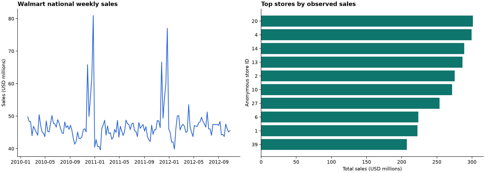

# Walmart Sales Analysis

**MySQL 8.4 · SQL · Python | 421,570 weekly sales observations**

A reproducible MySQL warehouse and reporting project using public Walmart recruiting competition data. It evaluates store performance, department sales, holiday patterns, and simple forecasting baselines at the dataset's actual store-department-week grain.



| Scope | Measured result |
|---|---:|
| Store-department-week rows | 421,570 |
| Stores / anonymous departments | 45 / 81 |
| Observation period | Feb 2010 – Oct 2012 |
| Recorded sales | $6,737,218,987.11 |
| Negative sales rows retained | 1,285 |
| Highest total-sales store | Store 20 |

These are **weekly aggregate records**, not individual transactions. This source has no operating hours, cities, customer identities, item names, costs, inventory, or channel flags. Profitability, peak-hour, customer, and supply-chain improvements cannot be inferred from it.

## Reproduce

Install Python 3.13 and Docker with Compose. From this repository's root:

```bash
python3 -m venv .venv
source .venv/bin/activate
pip install -r requirements-dev.txt
cp .env.example .env
export MYSQL_PASSWORD=local-analysis-only
docker compose up -d --wait
python -m src.download
python -m src.analyze
```

The example password is a disposable local development value. If you change it, set the same value in `.env` and your shell. Docker binds MySQL only to `127.0.0.1:3307`. If MySQL already exists elsewhere, set `MYSQL_HOST`, `MYSQL_PORT`, `MYSQL_USER`, `MYSQL_PASSWORD`, and `MYSQL_DATABASE`; use a database dedicated to this project. The pipeline rebuilds its `sales`, `stores`, `external_features`, and reporting views on each run.

Downloads are from a pinned public mirror commit of the original [Walmart competition files](https://www.kaggle.com/competitions/walmart-recruiting-store-sales-forecasting/data), verified with SHA-256. Raw data is excluded from Git. See [provenance](docs/DATA.md) for original terms and download URLs.

To analyze your own files with the same schema: `python -m src.analyze --raw-dir /path/to/folder` containing `train.csv`, `stores.csv`, and `features.csv`. Custom inputs need at least 64 contiguous weeks to support the 52-week seasonal lag and 12-week forecast holdout in this reporting pipeline.

## SQL model

| Object | Grain / responsibility |
|---|---|
| `stores` | One row per anonymous store; type and floor area |
| `sales` | One row per store, department, and week; DECIMAL currency |
| `external_features` | One row per store and week; macro and markdown features |
| `sales_features` | Safe joins, date features, previous observed sale and gap length |
| `store_performance` | Total and average weekly sales, volatility, sales/sqft, ranking |
| `department_performance` | Department sales, coverage, negative-sales counts |
| `weekly_sales` | National weekly totals and week-over-week growth |
| `holiday_comparison` | Descriptive holiday/nonholiday weekly comparisons |
| `forecast_backtest` | Final 12 weeks, rolling one-week-ahead baseline predictions |

Primary keys and pre-load checks prevent duplicate-grain joins. Foreign keys reject unknown stores. Source holiday flags are reconciled across files. Missing markdowns stay null; negative sales stay in totals. Python Decimal values and MySQL DECIMAL reconcile loaded totals to the cent. `LAG` in `sales_features` refers to the previous **observed** row; the gap-length field distinguishes missing weeks.

Example SQL after connecting with a MySQL client:

```sql
SELECT store_id, store_type, total_sales, avg_weekly_sales_per_sqft
FROM store_performance
ORDER BY sales_rank
LIMIT 10;

SELECT * FROM department_performance WHERE sales_rank <= 10;
SELECT * FROM holiday_comparison;
```

## Forecast validation

The final 12 observed weeks are evaluated as **rolling one-week-ahead** predictions. The previous actual week is available at each prediction origin; the seasonal baseline uses the actual week exactly 364 days earlier. These are not single-origin 12-week forecasts. WMAE weights holiday weeks by five and other weeks by one, at the **national weekly total** grain.

| Baseline | Holdout WMAE |
|---|---:|
| Previous week | $1,119,622.11 |
| Same week 52 weeks earlier | $1,122,689.16 |

This is a planning benchmark, not a department-level competition score or a deployed forecast. Full results are in [findings](reports/findings.md) and [metrics](reports/metrics.json).

## Tests and cleanup

```bash
# Unit checks only, without database credentials:
env -u MYSQL_PASSWORD python -m pytest -q

# Start a separate disposable service/database for integration tests:
MYSQL_PORT=3308 MYSQL_DATABASE=walmart_test docker compose -p walmart-sales-tests up -d --wait
MYSQL_PORT=3308 MYSQL_DATABASE=walmart_test python -m pytest -q
MYSQL_PORT=3308 MYSQL_DATABASE=walmart_test docker compose -p walmart-sales-tests down

# Stop the local service, retaining its project volume:
docker compose down
```

CI runs against an isolated MySQL service. Tests cover duplicate-grain rejection, unknown stores, missing features, complete loading, negative sales, reporting exports, and forecast windows. Integration tests require a database name ending in `_test` and use temporary output folders. Do not point the rebuild pipeline at a database containing other work under the same table names.

See [SQL](sql/), [data exports](data/processed/), and [resume bullets](docs/RESUME.md). MIT applies to original code; source data retains its original terms.

## Continuous integration template

A ready-to-use [GitHub Actions template](docs/ci-template.yml) is included. The publishing login lacked GitHub’s `workflow` permission, so it is stored as documentation instead of an active workflow. After granting that permission, place it at `.github/workflows/ci.yml` to enable automated tests. All tests were run locally for this build.
